<p align="center">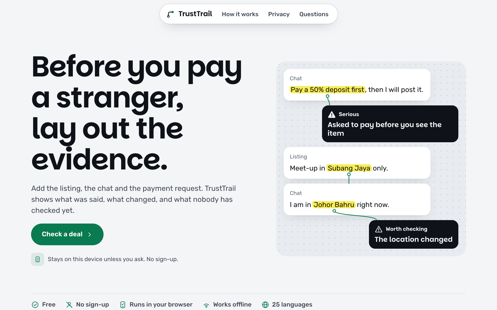</p>

# TrustTrail

**Lay out the evidence before you pay a stranger online.**

Try it: **https://trusttrail-yeegz.web.app** (open one of the Examples on the home page to explore without adding anything real)

You found a secondhand phone. The seller wants a deposit, asks to move to WhatsApp, and the bank account is in someone else's name. Each thing alone might be fine. TrustTrail puts the listing, the chat and the payment request side by side and shows:

- **the exact words** behind every warning sign,
- **what changed** between one message and the next,
- **what nobody has checked yet**, with the official place to check it.

It never calls a person a scammer, and it never calls a purchase safe. It shows you what is there and what is missing, then tells you plainly what to do next.

## Private by construction

Everything runs in your browser. No account, no server, no analytics. Screenshots are read on your device, and fixed rules decide the result. A full session makes **zero requests** to any other server (measured, not promised) unless you choose to ask for an AI explanation, and the site keeps working offline.

**Optional AI, both free.** "AI suggestions" says what is going on in plain language, then gives next steps tailored to the deal, each with a message you can copy and send, written in the language the seller uses. Where the browser has a built-in model it runs on your device. Otherwise you can ask Google's free Gemini: it asks first, every time, and blocks out phone, account, email and ID numbers before sending. The AI never decides the result, and anything it quotes is checked word for word against your evidence.

## A look around

| The result, in numbers | Each finding, tied to the words |
|---|---|
| 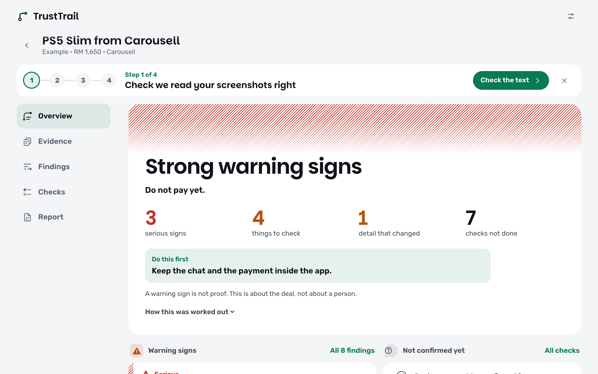 | 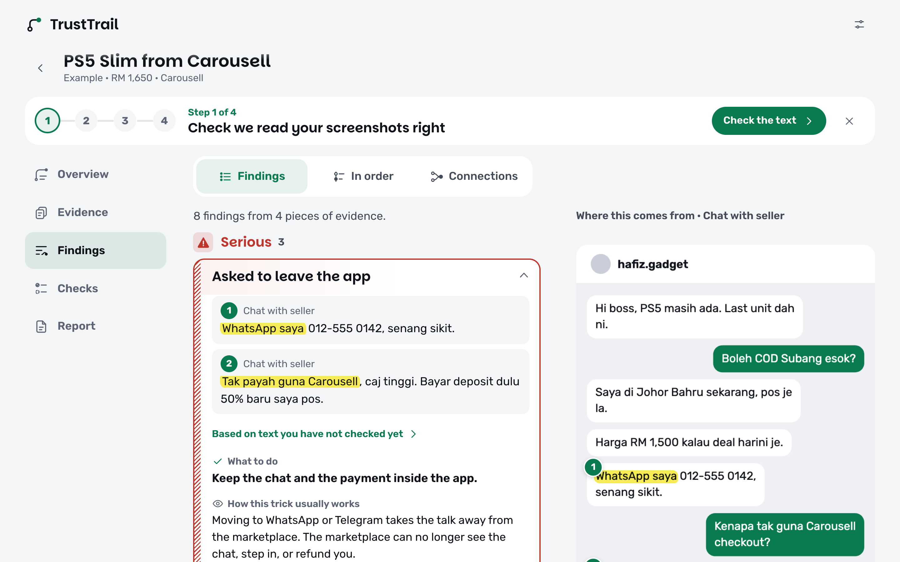 |
| **Check the text it read** | **Trace one finding back to its evidence** |
| 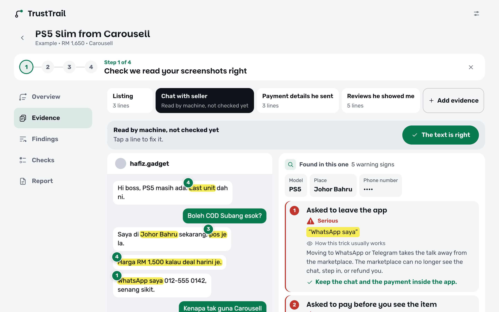 | 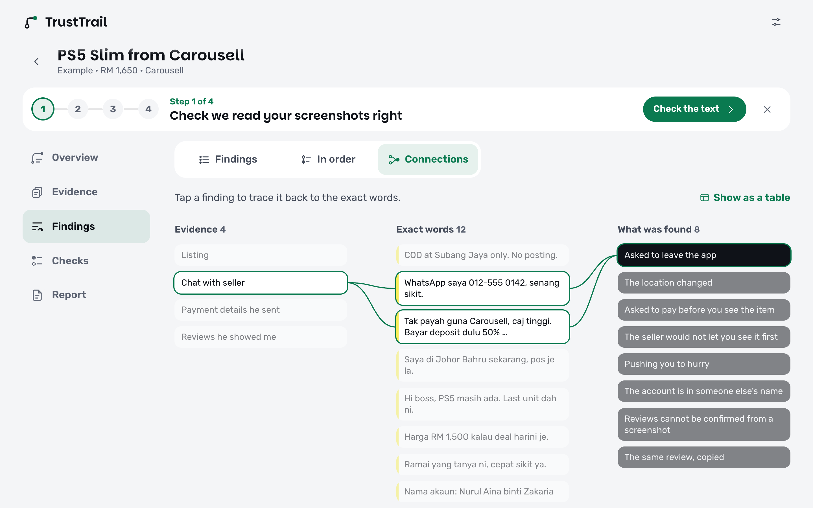 |
| **Checks only you can run** | **A report you can keep** |
| 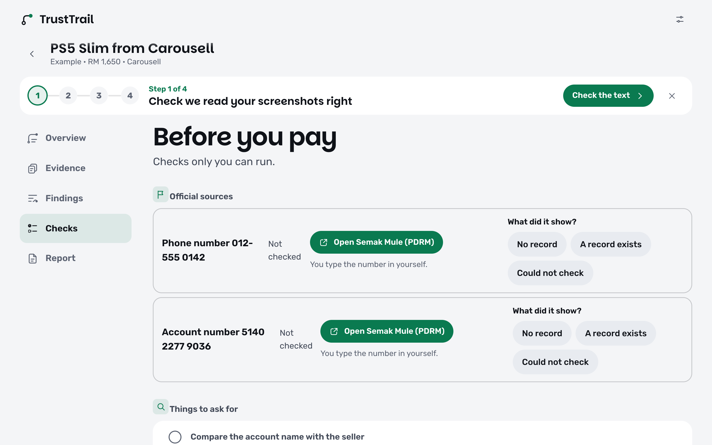 | 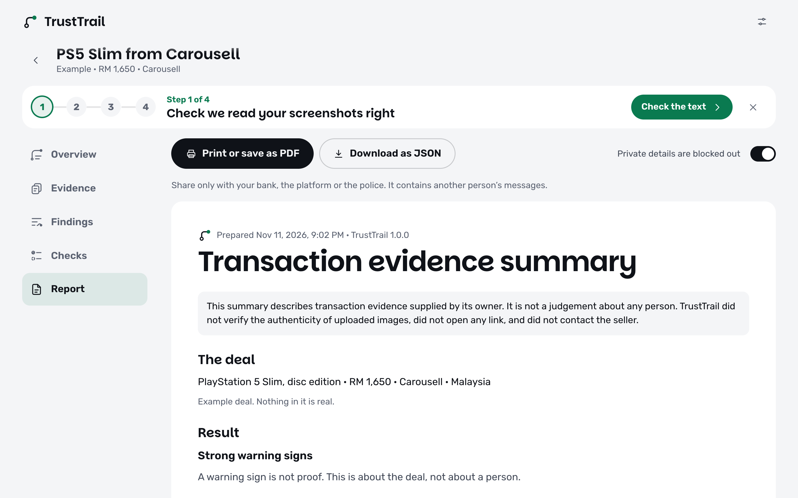 |

<p align="center">
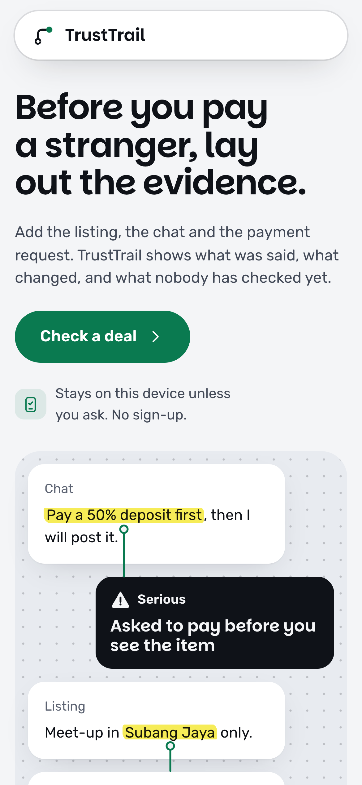
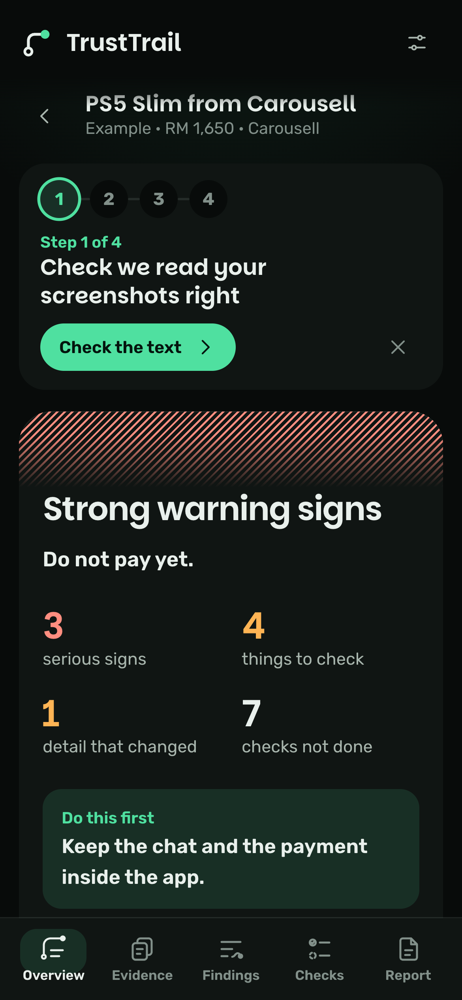
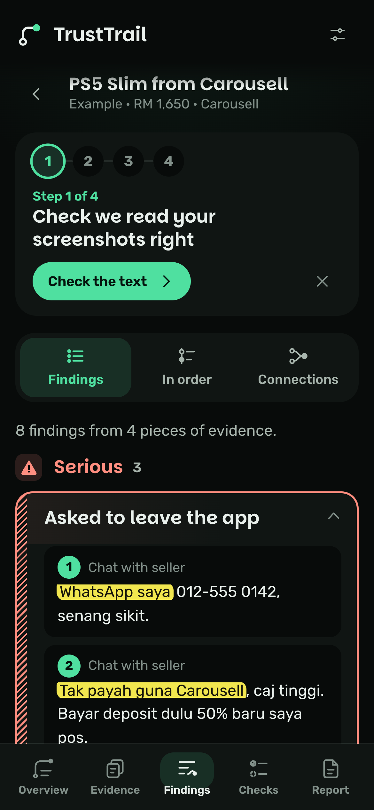
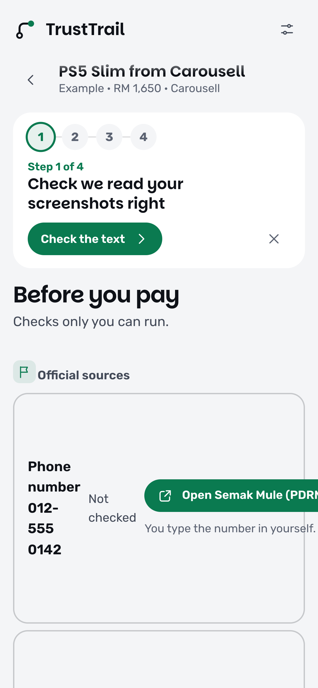
</p>

<p align="center">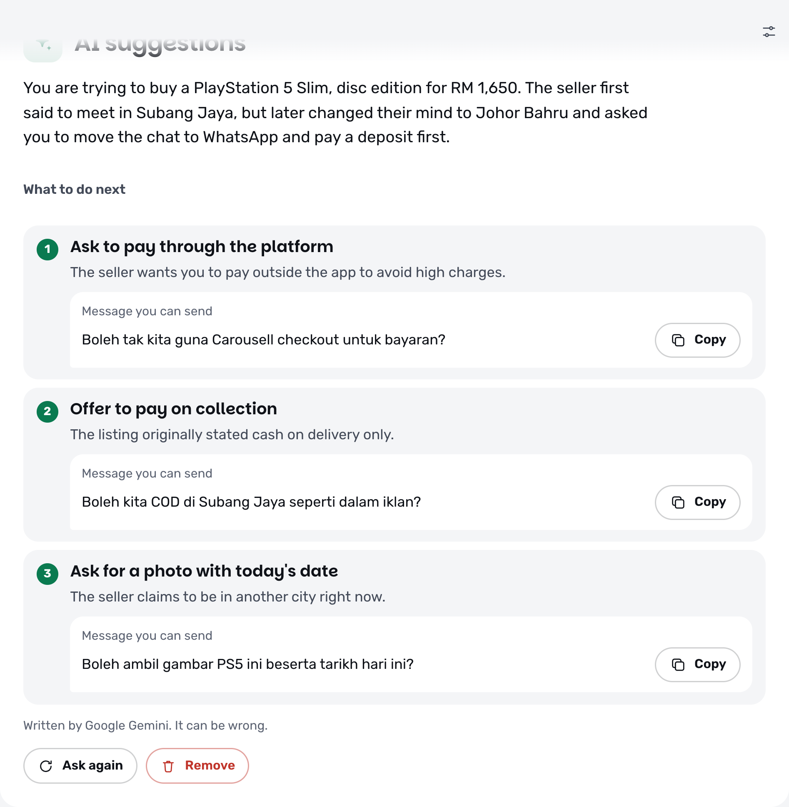</p>

## A short interview, one question at a time

After you add screenshots, TrustTrail asks about the payment, the seller and how the deal went. Answers sharpen the result, and they settle things a screenshot cannot, such as who suggested paying first.

| One question at a time | Updates as things happen |
|---|---|
| 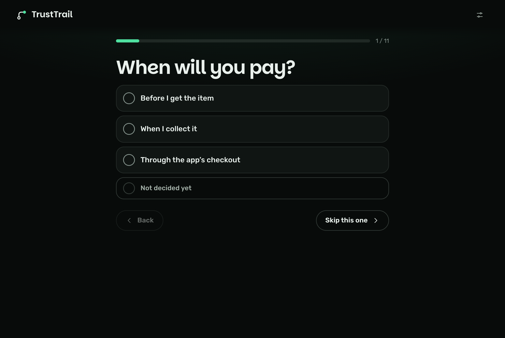 | 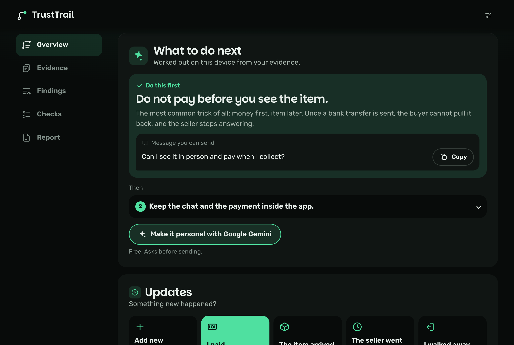 |

### It reads each screenshot and says why

Every screenshot gets its own panel: what was found in it, the exact words, how that trick usually works, and what to do. A seller profile that is four days old, unverified, with reviews that all arrived this week and tell you to "transfer without hesitating" is caught from the picture alone. Write what happened next in your own words ("I paid", "now he wants a shipping fee") and the page answers.

| Found in this screenshot | An update, understood |
|---|---|
| 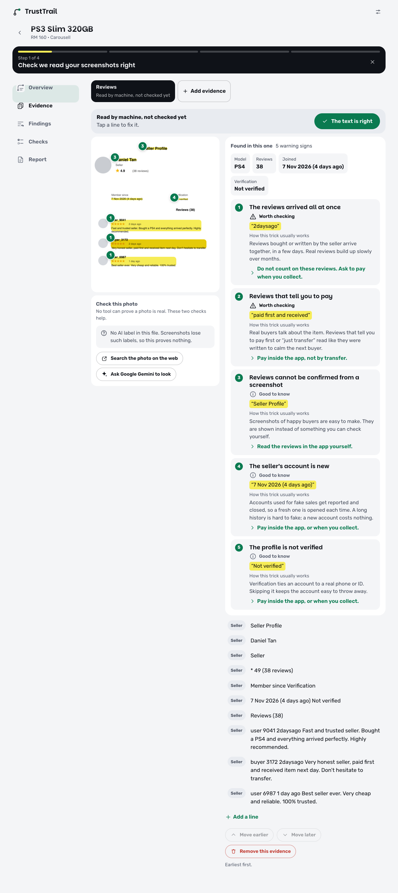 | 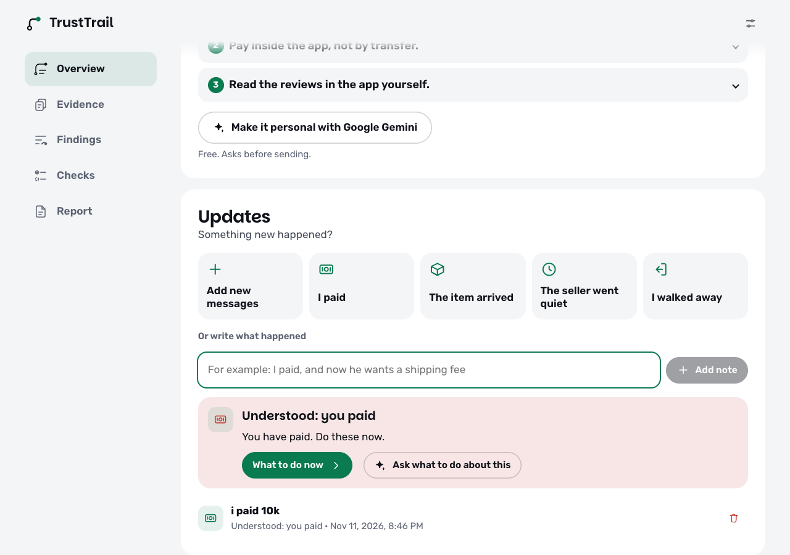 |

Picture checks stay honest: TrustTrail reads the AI label that many image tools write into a file, and never claims to tell a real photo from a fake one by looking at it.

## How it works

```
screenshots or pasted text
  → checked, size-capped and re-encoded on arrival
  → read on the device (English and Malay), one row per message
  → you correct anything it misread
  → 14 fixed, versioned rules read the original words and decide the result (no score)
  → contradictions, copied reviews and odd link spellings are picked out
  → one of six plain results, none of which is "safe"
  → what to do next, and what is still unchecked
```

Every finding must quote its source word for word. If you fix a misread line, the findings are worked out again from scratch, so nothing stale survives.

## Design

One idea carried everywhere: a claim is only as good as the words it rests on, so the words are struck with a highlighter and numbered, and the same number sits on the screenshot. Warning weight is shown with a plain icon and a word ("Serious", "Worth checking", "Good to know"), never with a verdict stamp. Green is the working colour, red is kept for deleting things, and dark mode is its own design: green-tinted near-black, lit from above, with highlighter marks that stay bright. A guide bar walks you through one real step at a time, named from your own case ("Check 012-555 0142 with Semak Mule").

Built to be usable by anyone: large touch targets, plain words, numbers first, detail tucked behind "More detail", 25 interface languages including right-to-left, light and dark, phone to desktop.

## Engineering, measured on 11 Nov 2026

| | |
|---|---|
| Automated tests | 1,497 passing |
| Fictional rule fixtures | 840 (English, Malay, mixed Manglish) |
| Findings quoting their source word for word | 537 of 537 |
| Injected instructions that changed a result | 0 of 130 |
| Disguised links flagged / real hosts wrongly flagged | 17 of 17 / 0 of 15 |
| Requests to other servers in a full session | 0 |
| New check with a screenshot, click to result | about 5 s |

Stack: TypeScript, React, Vite, IndexedDB, Tesseract compiled to WebAssembly (self-hosted), Chrome's on-device Prompt API, Gemini free tier (opt-in), strict Content-Security-Policy. No backend, and nothing that can produce a bill.

## The landing page

| Light | Dark |
|---|---|
| 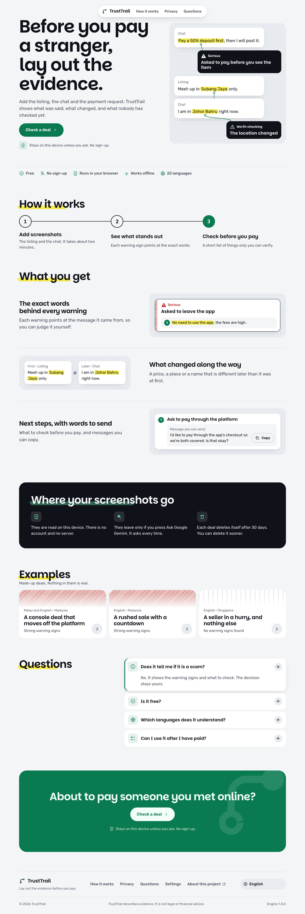 | 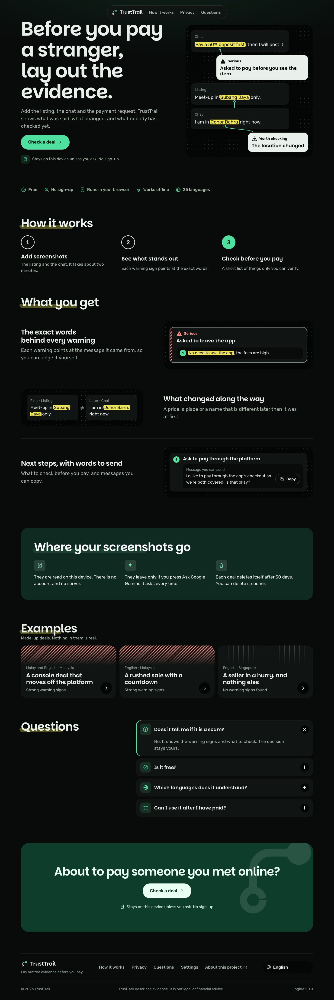 |

## Honest status

- The rules are tested only on **fictional examples written by the same person who wrote the rules**. That shows the engine does what was intended; it does not show how accurate it is on real conversations.
- Screenshots are read in **25 languages**, and numbers, names, links, the interview and AI suggestions work in all of them. The word-by-word warning rules exist for **English and Malay** only, both labelled beta.
- Only the English text has been reviewed by a person. The other 24 languages are machine-drafted previews and say so in Settings.
- Official check routes are verified for **Malaysia and Singapore** only.
- No user study has been run yet and no independent security review. Accessibility passes an automated audit (0 violations on every screen); a screen-reader pass with real users is still to do.

More: [build report](docs/REPORT.md) · [decisions](docs/DECISIONS.md) · [threat model](docs/THREAT_MODEL.md) · [benchmark](docs/BENCHMARK.md)

The source is in a private repository. This showcase is MIT licensed.
